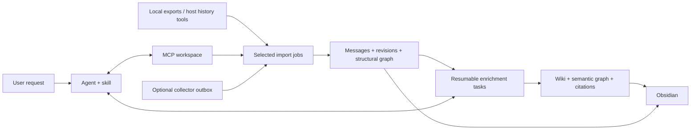

# Portable Context

A shared memory operated through your agent: import selected conversations, preserve native
relationships, build an evidence-linked Markdown wiki, and continue the work from another client.

**Status: 0.3, with owner-operated deployment and recoverable backups.** No personal account exports
or native agent installations have been tested yet. This is not a promise to recover deleted,
hidden, inaccessible, or unexported context. See [coverage and gaps](docs/connectors.md).

[Start with the user journey](docs/user-journey.md) · [Русское введение](docs/README.ru.md) · [Connector coverage](docs/connectors.md)
· [Data contract](docs/data-contract.md) · [Agent skill](skills/portable-context/SKILL.md)

## Deploy your own memory

Ask an agent with terminal access: **“Install this skill and deploy my memory in my Cloud.ru
account”** or **“Set it up on my existing server.”** Follow the
[agent deployment guide](skills/portable-context/references/deployment.md) (Russian).

The installer in `deploy/setup.py` provisions a VM, persistent disk, restricted SSH access,
private S3 bucket and bucket-scoped backup credentials. It separates a reviewed paid Terraform
plan from apply, keeps state on the owner's computer, and resumes failed server installation.
The desktop agent connects over SSH/stdio; no domain or public HTTP MCP is required. Existing
Linux servers use the same installer without Terraform. Each owner runs and pays for their own instance.

`bootstrap` verifies pinned Terraform/provider downloads. `install` verifies backup restoration
(including an S3 upload/download when configured), and `check` verifies the MCP workspace identity.
Credentials, state and personal data must remain outside this repository. A real Cloud.ru pilot
has verified provisioning, Windows-to-Linux MCP access, S3 upload/download/restore, and daily cron setup.
This is one tested account/configuration, not coverage of every region, image or client.
Automatic setup targets Ubuntu 24.04 / Linux with Python 3.11+, OpenSSH and cron.

Client setup, local imports, memory and MCP support Windows, macOS and Linux. The CI matrix
covers macOS on Intel and Apple Silicon, Windows x64, and Linux x64; core tests also run on
Linux ARM64. Cloud.ru provider 2.1.6 has no native Linux ARM64 binary, so provision from a
supported client or use the existing-server SSH path. The managed server installer targets Linux.

For VPN access, `deploy/network.py` provides `inspect`, `plan`, `apply`, `repair` and `remove`
on all three client OSes. It uses exact IPv4 host routes, records ownership, preserves unrelated
routes, and refuses stale plans. Changes require OS administrator/root privileges. After reboot
or a network change, run a fresh repair plan; no privileged background service is installed.
See the [network guide](skills/portable-context/references/network.md).

## Architecture



MCP receives only what the client sends. **Connecting MCP alone does not record conversations.**
Continuous capture requires a collector, persisted-message hook, or periodic export.
Original transcripts, manually curated memory, and model inferences stay distinguishable.
No external model, embedding service, telemetry, or API key is required by the core.
The connected agent performs semantic analysis using its own model. Native history access is a
separate capability; an MCP connection does not grant an application's full account history.

## Install

First choose where memory and MCP will live: [storage and setup guide](skills/portable-context/references/storage.md)
(Russian, with runnable local/server examples). Each user runs their own instance; this repository
does not provide hosted storage. Only filesystem/SQLite storage is implemented; S3 can hold external
backups, not the live database. MCP-only clients can read `portable-context://setup`.

Python 3.11+ with SQLite FTS5. From this repository:

```sh
python -m venv .venv
# Linux/macOS:
. .venv/bin/activate
# Windows PowerShell instead:
# .\.venv\Scripts\Activate.ps1
python -m pip install -e ".[mcp]"
portable-context --home /absolute/private/memory init
```

The core also runs without dependencies: `python -m pip install -e .`.
Keep the memory directory **outside this public repository**. It contains private originals,
messages, media inside ZIPs, and notes. `.gitignore` is a backup precaution, not a privacy boundary.

## Ask your connected agent

> Explain how to use this memory and what history you can access.
>
> Import the Atlas conversations and their forks.
>
> Build a wiki of the decisions, then connect related topics.
>
> Resume the work from the other agent and add new discussions.

`memory_status` identifies the shared workspace and actual source access. `preview_source` lets
the agent select conversations. Import and enrichment are separate resumable jobs. The agent can
read complete source revisions, update existing pages with conflict checks, and commit typed links.
Read the [complete user journey](docs/user-journey.md) before configuring individual adapters.

## Register a source once

For a server-local file, explicitly register it with the local CLI:

```sh
portable-context --home /private/memory connect claude-personal --format claude --instance claude-personal --location /private/exports/claude.zip
portable-context --home /private/memory preview claude-personal
```

Alternatively, allow an export folder using repeatable `mcp --source-root /private/exports` or
`PC_SOURCE_ROOTS` (OS path-list separator); the connected agent can then register files inside it.
MCP local paths refer to the **server**, not the remote client's disk. Hosts with their own history
tools register a host source without a path, then send selected records through `stage_records`.

Selection-aware jobs retain selected normalized records and raw message fields only. They never
copy a mixed source ZIP containing unselected chats. Small text exports can use `stage_export`;
larger exports should be registered server-locally or sent as selected record batches by a host bridge.

## Legacy full-archive import and inspection

An instance is a stable, non-secret account/device/server name. Reuse it on later imports;
give distinct instances distinct names. Do not use a new random name for each run.

```sh
portable-context --home /private/memory import claude-export.zip --format claude --instance claude-personal
portable-context --home /private/memory import chatgpt-export.zip --format chatgpt --instance chatgpt-personal
portable-context --home /private/memory import result.json --format telegram --instance telegram-personal
portable-context --home /private/memory import takeout.zip --format gemini --instance gemini-personal
portable-context --home /private/memory import /path/to/codex/sessions --format codex --instance codex-laptop
portable-context --home /private/memory search "project name"
portable-context --home /private/memory stats
portable-context --home /private/memory vault
```

Open `/private/memory/vault` as an Obsidian vault. `INDEX.md` links conversations, the graph and wiki.
`wiki/*.md` contains agent-maintained knowledge with source revisions; `memory/*.md` preserves
legacy 0.1 notes. Manual edits are immediately visible through the corresponding MCP read tools.
Generated transcript edits are preserved: subsequent projections write `.incoming.md` and
report conflicts. Merge them manually if wanted. No Obsidian plugin is required.

Reports show inserted/revised/unchanged counts, source archive hashes, warnings and errors.
Each input member is transactional. Errors yield exit code 1; successful earlier members remain
committed, and originals remain available for inspection. ZIP imports retain all media in the
original ZIP; directory imports retain selected data files only. No attachment OCR or extraction yet.
A single text file/member is limited to 128 MiB; selected ZIP members total at most 512 MiB.

## Connect an agent

Use the absolute executable from the environment where the package is installed:

```json
{
  "mcpServers": {
    "portable-context": {
      "command": "/absolute/repo/.venv/bin/portable-context",
      "args": ["--home", "/absolute/private/memory", "mcp"]
    }
  }
}
```

This is the common MCP shape, not a claim that every host uses the same configuration file.
Windows command example: `C:\\tools\\portable-context\\.venv\\Scripts\\portable-context.exe`.
For Codex, the corresponding TOML section is:

```toml
[mcp_servers.portable_context]
command = "/absolute/repo/.venv/bin/portable-context"
args = ["--home", "/absolute/private/memory", "mcp"]
```

Main workflow tools: `memory_status`, `connect_source`, `preview_source`, `start_import`,
`stage_records`, `run_import`, `get_job`, `start_enrichment`, `claim_enrichment`,
`read_source_revision`, `search_wiki`, `read_wiki`, `commit_enrichment`, `inspect_graph`,
`check_memory`, `refresh_vault`. The 0.1 message and note tools remain compatible.
Call schemas and examples are in the [skill protocol reference](skills/portable-context/references/protocol.md).

Install/copy [the skill](skills/portable-context/SKILL.md) into your agent's supported skills
directory, or use its instructions directly. It describes citation and memory-writing practice;
it is **not** a substitute for a collector or a native plugin for every host.

For a server shared by your agents, set `PC_MCP_TOKEN` to a random secret (at least 24 characters)
and use `mcp --transport streamable-http --port 8766`. Clients send `Authorization: Bearer <token>`.
It binds **127.0.0.1 only**: use an SSH tunnel or HTTPS gateway for remote clients. This is bearer
authentication for clients that support custom headers; OAuth-only web clients need a compatible
gateway. No OAuth issuer is bundled. `--allow-unauthenticated-local` explicitly opts out on trusted
loopback setups. This is a single-owner workspace; sources and filters are not per-user ACLs.

## Optional continuous capture

The primary workflow is on demand. Existing source integrations can use `enqueue_batch` and
`/v1/batches` to feed exactly the same resumable import jobs as interactive clients. Register the
producer as a host source first. Automatic capture and automatic semantic reasoning are separate:
new data becomes pending work, and a connected agent can enrich it later. No background model
worker or native capture hook is installed by default.

For local JSONL sessions (not Codex's newer paginated storage):

```sh
portable-context --home /private/memory watch /path/to/codex/sessions --format codex --instance codex-laptop
```

Run a second watcher for archived sessions. `--once` is suitable for a scheduler. A file hash
checkpoint is saved only after commit. Incomplete JSONL files are retried on the next pass.
The first version rescans changed files and archives complete snapshots: robust for moderate
histories but potentially expensive for large growing logs. Set a sensible interval and monitor disk.
Vault projection is explicit (`vault` / `refresh_vault`); database search is current immediately.

For Ouroboros or another controllable agent, call the producer example from the point where
the agent has persisted a message. See [examples/producer.py](examples/producer.py). Each
server has a separate instance ID and a private outbox. An independent worker retries delivery:

```sh
# Set PC_INGEST_TOKEN to the same random secret on receiver and producer.
portable-context --home /private/memory serve-ingest --port 8765
portable-context flush --outbox /private/outbox --endpoint http://127.0.0.1:8765 --loop
```

For separate servers, forward loopback via SSH or an authenticated HTTPS proxy. The receiver
binds loopback and requires a bearer token of at least 24 characters. Generate it locally with
`python -c "import secrets; print(secrets.token_urlsafe(32))"`; don't commit or paste it into chat.
Completed batches become `.sent`; failed batches remain `.json`. Stable message IDs make
retries idempotent. Run one delivery worker per outbox. A service manager must restart workers
after crashes/reboots; this package does not silently install background services.

The producer adapter and shared-job delivery are functional, but wiring them into a particular Ouroboros/Hermes/OpenClaw
version is a deployment task. No native integration is claimed tested in this release.

## Portability and recovery

```sh
portable-context --home /private/memory export /private/current-events.jsonl
portable-context --home /private/memory export /private/all-revisions.jsonl --revisions
```

The JSONL contract preserves roles, IDs, branches, timestamps, attachment references, and raw
message fields. A complete backup is the whole memory directory: SQLite, originals and vault.
Stop writers before a whole-directory filesystem copy. Alternatively, `python -m portable_context.backup`
creates a consistent SQLite snapshot, copies referenced originals, and keeps Markdown in a separate
recovery folder; `restore` validates checksums and regenerates the canonical wiki in a new directory.
Optional `.[backup]` dependencies enable S3 delivery. JSONL alone does not include originals,
wiki/semantic graph history, jobs or import audit metadata.
There is no account-wide sync, encryption, retention/deletion UI or multi-user isolation yet.

Upgrading from 0.1 adds tables and backfills structural links from current records. Legacy notes
and originals are preserved. Back up the complete memory directory before upgrading; do not run
an older writer against an upgraded memory. Wiki database commits are authoritative and Markdown
projection can be repaired with `vault` after a crash. Manual file edits require reconciliation.

## Development

```sh
python -m pip install -e ".[mcp]"
python -m unittest discover -s tests -v
```

Tests use generated synthetic records only. They exercise replay, revisions, transaction rollback,
parallel writers, branch preservation, Unicode search, manual edits, original ZIP retention,
watcher recovery, authenticated delivery, two-client handoff, selective-import privacy,
leases, wiki/graph transaction rollback, stale source detection and authenticated HTTP MCP.

```sh
python examples/agent_workflow_demo.py --home /new/private/demo-directory
```

The demo is scripted synthetic content; it does not make model calls or access real accounts.

MIT licensed. Contributions should include anonymized minimal fixtures for schema differences;
never attach real conversation archives to public issues. Read [CONTRIBUTING.md](CONTRIBUTING.md).
