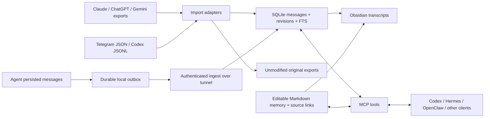

# Portable Context

A local-first archive and editable memory layer across AI products. Import exports,
keep originals, search messages, link notes in Obsidian, and let agents read/write via MCP.

**Status: working 0.1 prototype, tested with synthetic fixtures.** No personal account exports
or native agent installations have been tested yet. This is not a promise to recover deleted,
hidden, inaccessible, or unexported context. See [coverage and gaps](docs/connectors.md).

[Русское введение](docs/README.ru.md) · [Connectors and continuous capture](docs/connectors.md)
· [Data contract](docs/data-contract.md) · [Agent skill](skills/portable-context/SKILL.md)

## Architecture



MCP receives only what the client sends. **Connecting MCP alone does not record conversations.**
Continuous capture requires a collector, persisted-message hook, or periodic export.
Original transcripts, manually curated memory, and model inferences stay distinguishable.
No external model, embedding service, telemetry, or API key is required by the core.

## Install

Python 3.11+ with SQLite FTS5. From this repository:

```sh
python -m venv .venv
# Linux/macOS:
. .venv/bin/activate
# Windows PowerShell instead:
# .\.venv\Scripts\Activate.ps1
python -m pip install -e ".[mcp]"
portable-context --home /absolute/private/memory init
```

The core also runs without dependencies: `python -m pip install -e .`.
Keep the memory directory **outside this public repository**. It contains private originals,
messages, media inside ZIPs, and notes. `.gitignore` is a backup precaution, not a privacy boundary.

## Import and inspect

An instance is a stable, non-secret account/device/server name. Reuse it on later imports;
give distinct instances distinct names. Do not use a new random name for each run.

```sh
portable-context --home /private/memory import claude-export.zip --format claude --instance claude-personal
portable-context --home /private/memory import chatgpt-export.zip --format chatgpt --instance chatgpt-personal
portable-context --home /private/memory import result.json --format telegram --instance telegram-personal
portable-context --home /private/memory import takeout.zip --format gemini --instance gemini-personal
portable-context --home /private/memory import /path/to/codex/sessions --format codex --instance codex-laptop
portable-context --home /private/memory search "project name"
portable-context --home /private/memory stats
portable-context --home /private/memory vault
```

Open `/private/memory/vault` as an Obsidian vault. `INDEX.md` links conversations and memory.
`memory/*.md` is editable and immediately searchable through MCP; no re-index is needed.
Generated transcript edits are preserved: subsequent projections write `.incoming.md` and
report conflicts. Merge them manually if wanted. No Obsidian plugin is required.

Reports show inserted/revised/unchanged counts, source archive hashes, warnings and errors.
Each input member is transactional. Errors yield exit code 1; successful earlier members remain
committed, and originals remain available for inspection. ZIP imports retain all media in the
original ZIP; directory imports retain selected data files only. No attachment OCR or extraction yet.
A single text file/member is limited to 128 MiB; selected ZIP members total at most 512 MiB.

## Connect an agent

Use the absolute executable from the environment where the package is installed:

```json
{
  "mcpServers": {
    "portable-context": {
      "command": "/absolute/repo/.venv/bin/portable-context",
      "args": ["--home", "/absolute/private/memory", "mcp"]
    }
  }
}
```

This is the common MCP shape, not a claim that every host uses the same configuration file.
Windows command example: `C:\\tools\\portable-context\\.venv\\Scripts\\portable-context.exe`.
For Codex, the corresponding TOML section is:

```toml
[mcp_servers.portable_context]
command = "/absolute/repo/.venv/bin/portable-context"
args = ["--home", "/absolute/private/memory", "mcp"]
```

Tools: `search_messages`, `read_message`, `list_conversations`, `read_conversation`,
`append_messages`, `search_memory`, `read_memory`, `write_memory`, `refresh_vault`.

Install/copy [the skill](skills/portable-context/SKILL.md) into your agent's supported skills
directory, or use its instructions directly. It describes citation and memory-writing practice;
it is **not** a substitute for a collector or a native plugin for every host.

For a server shared by your agents, use `mcp --transport streamable-http --port 8766`.
It binds **127.0.0.1 only**, with no built-in HTTP authentication for MCP. Use an SSH tunnel
on trusted machines, or deploy an authenticated gateway. Do not expose the raw endpoint to
the internet. Single-owner service: source filters are convenience filters, not access control.

## Keep memory alive

For local JSONL sessions (not Codex's newer paginated storage):

```sh
portable-context --home /private/memory watch /path/to/codex/sessions --format codex --instance codex-laptop
```

Run a second watcher for archived sessions. `--once` is suitable for a scheduler. A file hash
checkpoint is saved only after commit. Incomplete JSONL files are retried on the next pass.
The first version rescans changed files and archives complete snapshots: robust for moderate
histories but potentially expensive for large growing logs. Set a sensible interval and monitor disk.
Vault projection is explicit (`vault` / `refresh_vault`); database search is current immediately.

For Ouroboros or another controllable agent, call the producer example from the point where
the agent has persisted a message. See [examples/producer.py](examples/producer.py). Each
server has a separate instance ID and a private outbox. An independent worker retries delivery:

```sh
# Set PC_INGEST_TOKEN to the same random secret on receiver and producer.
portable-context --home /private/memory serve-ingest --port 8765
portable-context flush --outbox /private/outbox --endpoint http://127.0.0.1:8765 --loop
```

For separate servers, forward loopback via SSH or an authenticated HTTPS proxy. The receiver
binds loopback and requires a bearer token of at least 24 characters. Generate it locally with
`python -c "import secrets; print(secrets.token_urlsafe(32))"`; don't commit or paste it into chat.
Completed batches become `.sent`; failed batches remain `.json`. Stable message IDs make
retries idempotent. Run one delivery worker per outbox. A service manager must restart workers
after crashes/reboots; this package does not silently install background services.

The producer adapter is functional, but wiring it into a particular Ouroboros/Hermes/OpenClaw
version is a deployment task. No native integration is claimed tested in this release.

## Portability and recovery

```sh
portable-context --home /private/memory export /private/current-events.jsonl
portable-context --home /private/memory export /private/all-revisions.jsonl --revisions
```

The JSONL contract preserves roles, IDs, branches, timestamps, attachments references, and raw
message fields. A complete backup is the whole memory directory: SQLite, originals and vault.
Stop writers before a filesystem copy, or use SQLite's backup API and separately back up originals
and Markdown. JSONL alone does not include originals, note history, or import audit metadata.
There is no account-wide sync, encryption, retention/deletion UI or multi-user isolation yet.

## Development

```sh
python -m pip install -e ".[mcp]"
python -m unittest discover -s tests -v
```

Tests use generated synthetic records only. They exercise replay, revisions, transaction rollback,
parallel writers, branch preservation, Unicode search, manual edits, original ZIP retention,
watcher recovery, authenticated delivery and an MCP subprocess round trip.

MIT licensed. Contributions should include anonymized minimal fixtures for schema differences;
never attach real conversation archives to public issues. Read [CONTRIBUTING.md](CONTRIBUTING.md).
